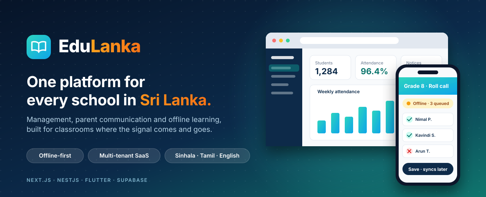
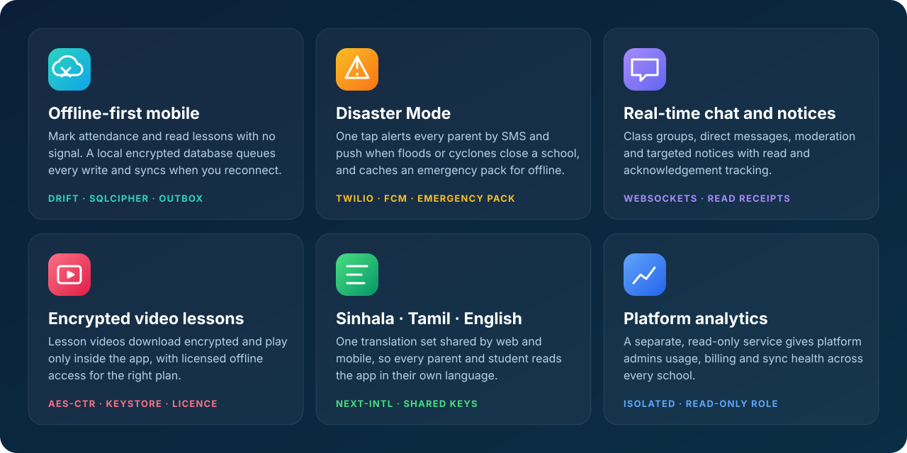
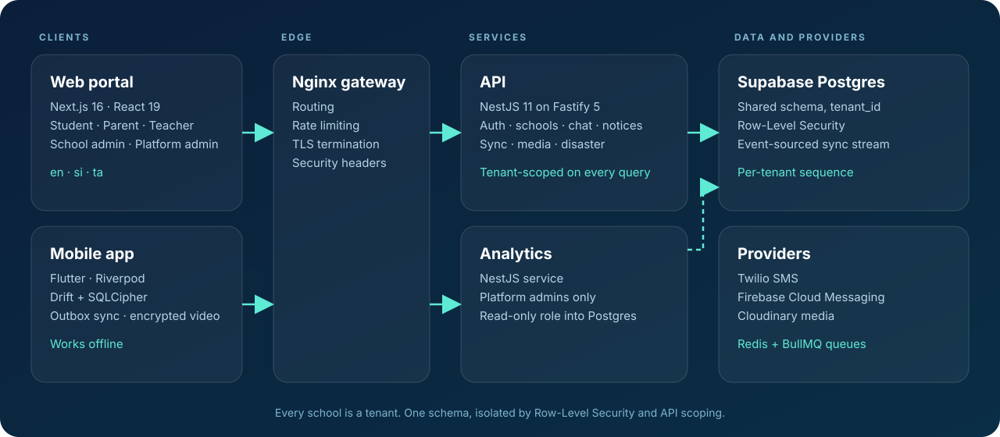
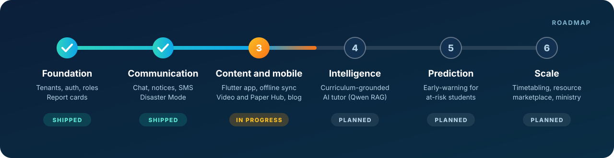
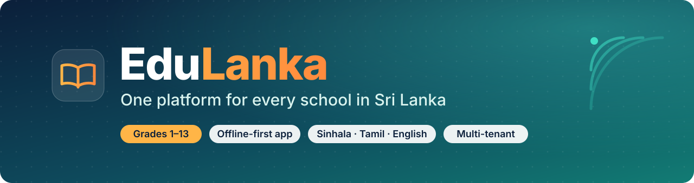

<div align="center">



<br/><br/>

[](https://github.com/Umesh080797668/EduLanka/actions/workflows/ci.yml)


### School management, parent communication and offline learning,<br/>built for the way Sri Lankan schools actually work.

**[Why](#-why-edulanka)** · **[Features](#-features)** · **[Architecture](#-architecture)** · **[Quick start](#-quick-start)** · **[Roadmap](#-roadmap)** · **[Docs](#-documentation)**

</div>

<br/>

## 💡 Why EduLanka

Most school software assumes fast internet, one language and one school at a time. Sri Lanka needs the opposite: thousands of schools, three languages, villages where the signal comes and goes, and floods or cyclones that can close a whole district overnight.

<table>
<tr>
<td width="25%" align="center"><h3>📴</h3><b>Works offline</b><br/>Mark attendance and read lessons with no signal. Everything syncs when it returns.</td>
<td width="25%" align="center"><h3>🗣️</h3><b>Speaks your language</b><br/>Sinhala, Tamil and English across web and mobile.</td>
<td width="25%" align="center"><h3>🚨</h3><b>Reaches parents</b><br/>Notices, chat, SMS and a one-tap Disaster Mode.</td>
<td width="25%" align="center"><h3>🏫</h3><b>Many schools, one platform</b><br/>Every school is an isolated tenant on shared infrastructure.</td>
</tr>
</table>

<br/>

## ✨ Features



### Built for every role

| | Role | What they get |
|:-:|---|---|
| 🎓 | **Students** | Grades and report cards, class chat, homework, offline video lessons, past papers with marking schemes, school blog |
| 👨‍👩‍👧 | **Parents** | Linked children's grades and profile, school notices, direct messaging with teachers, emergency alerts |
| 👩‍🏫 | **Teachers** | Gradebook, classes and homework, attendance, class resources, chat with students and parents |
| 🏫 | **School admins** | Students, teachers, parents and classes in one place, school policy, notices, SMS approval, emergency controls, sync health |
| 🛠️ | **Platform admins** | Tenant management, storage and SMS quotas, audit logs, tutorial authoring, release notes, platform analytics |

<br/>

## 🏗 Architecture



<details>
<summary><b>How multi-tenancy works</b></summary>
<br/>

Every school is a tenant in one shared Postgres schema. Every tenant-owned table carries a `tenant_id`, Row-Level Security policies key off the tenant claim in the user's token, and the API scopes every query to the caller's tenant as a second layer of defence.

</details>

<details>
<summary><b>How offline sync works</b></summary>
<br/>

Writes made offline are queued in an encrypted local database and pushed through an event-sourced stream. Each tenant has a monotonic sequence and idempotency keys on every event, so retries never duplicate or reorder data. Attendance conflicts are logged for review. See the [architecture decision records](docs/decisions).

</details>

<details>
<summary><b>How the isolated analytics service works</b></summary>
<br/>

Cross-school reporting runs in its own service. It is restricted to platform admins and connects to the database with a read-only role, so heavy reporting never touches the tenant request path.

</details>

<br/>

## 🧰 Tech stack

<table>
<tr>
<td align="center" width="16%"><b>Web</b><br/>Next.js 16<br/>React 19<br/>Tailwind 4</td>
<td align="center" width="16%"><b>API</b><br/>NestJS 11<br/>Fastify 5<br/>Swagger</td>
<td align="center" width="16%"><b>Mobile</b><br/>Flutter<br/>Riverpod<br/>Drift + SQLCipher</td>
<td align="center" width="16%"><b>Data</b><br/>Supabase Postgres<br/>Row-Level Security<br/>Redis · BullMQ</td>
<td align="center" width="16%"><b>Messaging</b><br/>Twilio SMS<br/>Firebase FCM<br/>WebSockets</td>
<td align="center" width="16%"><b>Tooling</b><br/>pnpm · Turborepo<br/>Jest · Playwright<br/>Docker · GitHub Actions</td>
</tr>
</table>

<br/>

## 🚀 Quick start

> **You need** Node.js 20+, pnpm 9, Docker 24+, a [Supabase](https://supabase.com) project, and the Flutter SDK for the mobile app.

```bash
git clone https://github.com/Umesh080797668/EduLanka.git
cd EduLanka
pnpm install
```

<details open>
<summary><b>1 · Configure</b></summary>
<br/>

Each app has its own environment file. Secrets are deliberately not shared between web and API.

```bash
cp apps/api/.env.example        apps/api/.env
cp apps/web/.env.example        apps/web/.env.local
cp apps/analytics/.env.example  apps/analytics/.env
```

Fill in your Supabase URL and keys, `JWT_SECRET` (32+ characters) and `INITIAL_SUPER_ADMIN_PASSWORD`. Twilio, Cloudinary and Firebase values are only needed for the features that use them. Details are in the [environment guide](ENVIRONMENT_SETUP.md).

</details>

<details open>
<summary><b>2 · Create the database</b></summary>
<br/>

```bash
npx supabase link --project-ref <your-project-ref>
npx supabase db push
pnpm --filter @edu-lanka/api seed:admin
```

</details>

<details open>
<summary><b>3 · Run the platform</b></summary>
<br/>

```bash
# Everything in Docker: API, web, analytics, Redis and the Nginx gateway
cd infrastructure/docker && docker compose up --build -d
curl http://localhost:8081/api/v1/health     # API health through the gateway
```

Open **http://localhost:3000**. Prefer watch mode? Start Redis, then run the apps directly:

```bash
docker run -d -p 6379:6379 redis:7-alpine
pnpm dev
```

</details>

<details>
<summary><b>4 · Run the mobile app</b></summary>
<br/>

```bash
cd apps/mobile
cp config.example.json config.json     # add your API, Supabase and Firebase values
flutter pub get
flutter run --dart-define-from-file=config.json
```

Push notifications also need your own `google-services.json` in `apps/mobile/android/app/`.

</details>

<details>
<summary><b>Useful commands</b></summary>
<br/>

| Command | What it does |
|---|---|
| `pnpm dev` | Start all apps in watch mode |
| `pnpm build` | Build every workspace |
| `pnpm lint` · `pnpm typecheck` | Lint and type-check everything |
| `pnpm test` | Unit tests |
| `pnpm test:e2e` | API end-to-end tests |
| `cd apps/mobile && flutter test` | Mobile tests |

</details>

<br/>

## 💳 Plans

Schools start free and grow. The platform enforces each tier's limits.

| | **Community** | **Starter** | **Growth** | **Institutional** |
|---|:-:|:-:|:-:|:-:|
| **Price** | Free | LKR 1,500 / mo<br/>+ LKR 20 / student | LKR 3,000 / mo<br/>+ LKR 40 / student | LKR 5,000 / mo<br/>+ LKR 60 / student |
| **Students** | Up to 75 active | Unlimited | Unlimited | Unlimited |
| **Storage** | Included allowance | 2 GB | 15 GB | 50 GB |
| **Enrolment, grades, report cards** | ✅ | ✅ | ✅ | ✅ |
| **Notices** | ✅ | ✅ | ✅ | ✅ |
| **Real-time chat, Disaster Mode** | | ✅ | ✅ | ✅ |
| **Offline sync** | | ✅ | ✅ Unlimited | ✅ Unlimited |
| **Encrypted video, Paper Hub** | | | ✅ | ✅ |
| **Analytics, ministry reporting** | | | | ✅ |

Pricing and limits live in the [blueprint](EduLanka-Phased-Blueprint.md).

<br/>

## 🗺 Roadmap



**Right now (Phase 3):** the Flutter app with its encrypted offline database and sync engine, an encrypted video player and downloads, the Paper Hub, mobile Disaster Mode and the school blog. Zonal, provincial and ministry portals arrive in later phases. The full plan is in the [phased blueprint](EduLanka-Phased-Blueprint.md).

<br/>

## 🔒 Security

- **Role-based access** for students, parents, teachers, school admins and platform admins.
- **Tenant isolation** through Row-Level Security plus API-level scoping on every query.
- **Sessions** with short-lived access tokens, refresh rotation and server-side revocation.
- **Abuse protection** with rate limiting at the gateway and the API, and validation on every endpoint.
- **Encrypted on device**: the local database uses SQLCipher and downloaded videos are encrypted at rest.

Read the [security review](SECURITY.md). Please report vulnerabilities privately to the maintainers, not in a public issue.

<br/>

## 🗂 Repository layout

```text
EduLanka/
├── apps/
│   ├── web/            Next.js portals for every role (en · si · ta)
│   ├── api/            NestJS REST + WebSocket API
│   ├── analytics/      Platform-admin analytics service
│   └── mobile/         Flutter offline-first app
├── packages/           shared-types · ui · config
├── supabase/           SQL migrations and seed data
├── infrastructure/     Docker, Nginx, k6 load tests, env templates
├── docs/               Architecture notes and decision records
└── .github/workflows/  CI and staging deployment
```

<br/>

## 📚 Documentation

| Topic | Where |
|---|---|
| Product vision and phased plan | [EduLanka-Phased-Blueprint.md](EduLanka-Phased-Blueprint.md) |
| System architecture | [docs/ARCHITECTURE.md](docs/ARCHITECTURE.md) |
| Architecture decisions (offline video, sync, push, mobile) | [docs/decisions](docs/decisions) |
| Environment variables | [ENVIRONMENT_SETUP.md](ENVIRONMENT_SETUP.md) |
| Deployment (Vercel, Netlify, Supabase, Docker) | [DEPLOYMENT_MANUAL.md](DEPLOYMENT_MANUAL.md) |
| Git workflow | [docs/BRANCHING_STRATEGY.md](docs/BRANCHING_STRATEGY.md) |
| Pilot onboarding | [docs/pilot-onboarding.md](docs/pilot-onboarding.md) |

<br/>

## 🤝 Contributing

Contributions are welcome. Read the [branching strategy](docs/BRANCHING_STRATEGY.md), then open a pull request against `main`. Run `pnpm lint`, `pnpm typecheck` and `pnpm test` first. CI runs the same checks.

<br/>

<div align="center">



**Built for Sri Lankan classrooms** 🇱🇰

</div>
